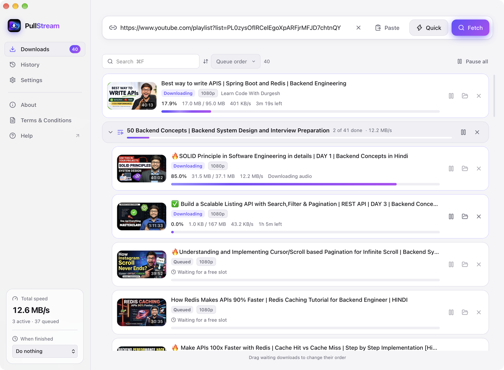
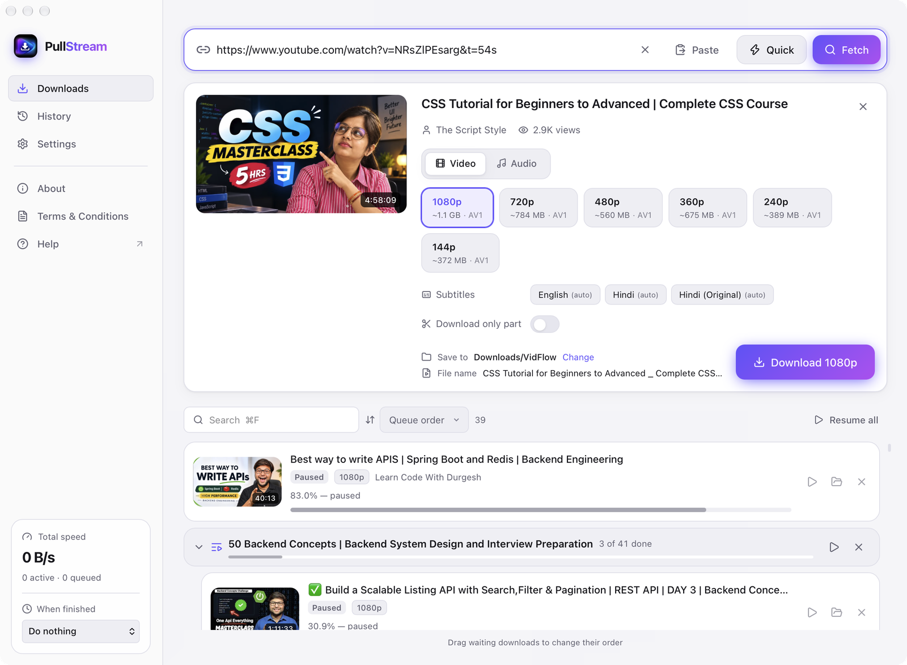
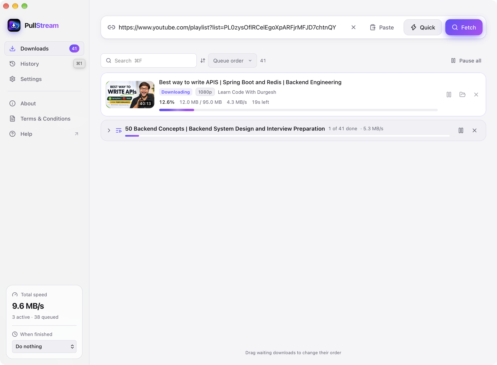
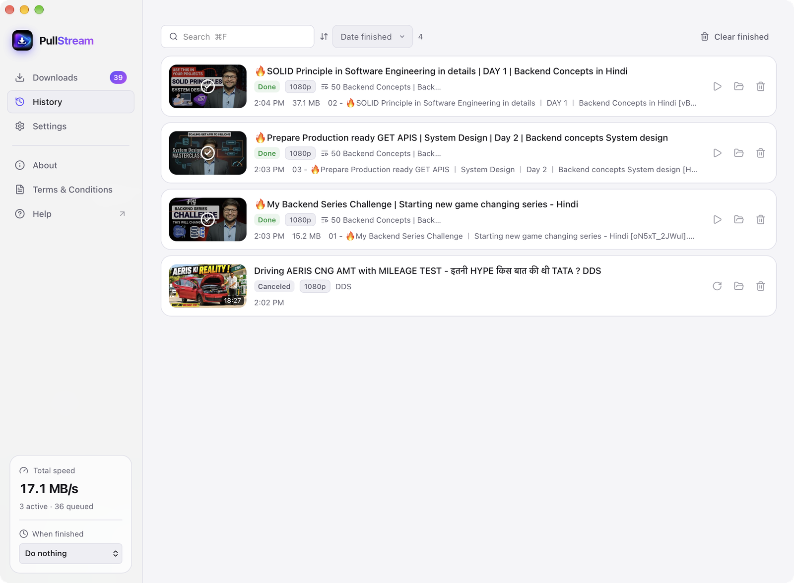
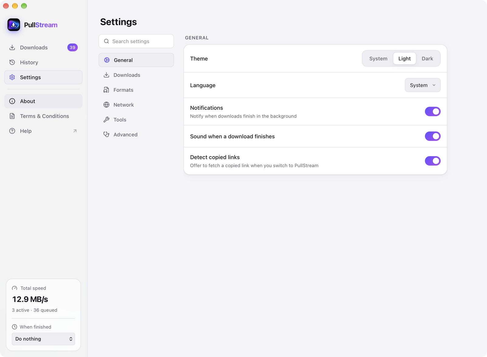

<div align="center">


# PullStream

**A fast, good-looking desktop downloader for videos and whole playlists.**

Paste a link, pick a quality, and PullStream downloads several videos at once,<br/>
then merges and converts them for you.

[](#installation)
[](#installation)
[](#installation)
[](https://tauri.app)
[](https://www.rust-lang.org)
[](https://react.dev)

[**Download**](../../releases/latest) · [Features](#features) · [Screenshots](#screenshots) · [Installation](#installation) · [Build from source](#building-from-source) · [Support](#support)

<br/>



</div>

---

> [!IMPORTANT]
> PullStream is an **unofficial** tool. It is not affiliated with YouTube, Google or any other website.
> YouTube does not officially support downloading its videos, so downloading from YouTube is **at your own risk**.
> Only download content you own or have permission to download. See [Legal](#legal).

## Contents

- [Features](#features)
- [Screenshots](#screenshots)
- [Installation](#installation)
- [First launch](#first-launch)
- [Using PullStream](#using-pullstream)
- [Troubleshooting](#troubleshooting)
- [Privacy](#privacy)
- [Building from source](#building-from-source)
- [Architecture](#architecture)
- [Releasing](#releasing)
- [Legal](#legal)
- [Credits](#credits)
- [Support](#support)

## Features

| | |
|---|---|
| ⚡ **Parallel downloads** | Download 1–10 videos at the same time, each over up to 16 connections. |
| 📃 **Whole playlists** | Load a playlist of any size, choose videos with checkboxes, and save them numbered in their own folder. |
| 🎬 **Any quality** | Video up to 4K/8K as MP4, with size estimates before you download. |
| 🎵 **Audio only** | Extract MP3, M4A, Opus, FLAC or WAV, with cover art and tags embedded. |
| 🌐 **1,000+ sites** | YouTube, Vimeo, X, Instagram and every other site [yt-dlp supports](https://github.com/yt-dlp/yt-dlp/blob/master/supportedsites.md). |
| ⏯️ **Full queue control** | Pause, resume, cancel and retry each download or all at once. Interrupted downloads continue after a restart. |
| 📋 **Smart link input** | Paste, drag and drop, or copy a link and PullStream offers to fetch it. Paste many links to queue them all. |
| 🪶 **Small and fast** | A ~10 MB app that starts instantly. Built with Rust and Tauri, not Electron. |
| 🌗 **Polished design** | Light and dark themes, live progress with speed and time left, and notifications when downloads finish. |
| 🗂️ **Organised queue** | Playlists grouped with combined progress, a separate History, search, sort, multi-select, right-click menus and drag-to-reorder. |
| ✂️ **Precise options** | Pick subtitle languages, download just part of a video, choose a folder per download, and see codec/HDR details. |
| 🩺 **Helpful errors** | Plain-language explanations with one-click fixes (use browser login, update yt-dlp, retry). |
| 🖥️ **Native feel** | macOS menu bar and shortcuts, translucent sidebar, Dock/taskbar progress, remembers window size, quit or sleep when done. |
| 🔄 **Auto-updates** | Signed in-app updates with a "What's new" screen. |
| 🌐 **English and हिन्दी** | Full UI in English and Hindi. |
| 🔒 **Private** | No account, no ads, no tracking. Everything runs on your computer. |

## Screenshots

<table>
  <tr>
    <td width="50%">
      
      <p align="center"><b>Preview before you download</b><br/><sub>Quality with size and codec, subtitles, trimming and save folder</sub></p>
    </td>
    <td width="50%">
      
      <p align="center"><b>Playlists stay tidy</b><br/><sub>Grouped into one row with combined progress and speed</sub></p>
    </td>
  </tr>
  <tr>
    <td width="50%">
      
      <p align="center"><b>History</b><br/><sub>Every finished download, searchable, one click to play or show in folder</sub></p>
    </td>
    <td width="50%">
      
      <p align="center"><b>Settings</b><br/><sub>Organised in tabs, with search, theme and language</sub></p>
    </td>
  </tr>
</table>

## Installation

Download the installer for your system from the [**latest release**](../../releases/latest).

| System | File | Notes |
|---|---|---|
| **macOS** 11+ | `PullStream_x.y.z_universal.dmg` | One file for Apple Silicon and Intel Macs. |
| **Windows** 10/11 | `PullStream_x.y.z_x64-setup.exe` | Recommended. An `.msi` is also available for managed installs. |
| **Linux** (x64) | `.AppImage`, `.deb` or `.rpm` | `.AppImage` runs on most distributions. Use `.deb` on Ubuntu/Debian or `.rpm` on Fedora. |

<details>
<summary><b>macOS</b>: "Apple cannot check it for malicious software"</summary>

<br/>

1. Open the `.dmg` and drag **PullStream** into **Applications**.
2. Open PullStream. If macOS blocks it, go to **System Settings → Privacy & Security**, scroll down and click **Open Anyway**.

This warning appears because the current builds are not yet notarized by Apple. You only need to do this once.

</details>

<details>
<summary><b>Windows</b>: "Windows protected your PC"</summary>

<br/>

1. Run `PullStream_x.y.z_x64-setup.exe`.
2. If SmartScreen appears, click **More info → Run anyway**.

PullStream installs for your user account only, so it doesn't need administrator rights.

</details>

<details>
<summary><b>Linux</b></summary>

<br/>

```bash
# AppImage (any distribution)
chmod +x PullStream_*.AppImage && ./PullStream_*.AppImage

# Debian / Ubuntu
sudo apt install ./PullStream_*_amd64.deb

# Fedora / RHEL
sudo dnf install ./PullStream-*.x86_64.rpm
```

</details>

## First launch

PullStream uses three free, open-source tools to do the heavy lifting. They aren't bundled, which keeps the installer small. On first launch, a setup screen downloads them once:

| Tool | What it does | Download size |
|---|---|---|
| [yt-dlp](https://github.com/yt-dlp/yt-dlp) | Reads videos and playlists from YouTube and 1,000+ sites | ~25–50 MB |
| [FFmpeg](https://ffmpeg.org) | Merges HD video with audio and converts to MP3 | ~55–115 MB |
| [Deno](https://deno.com) | Solves YouTube's playback checks | ~40 MB |

Click **Download & install** and wait about 30 seconds on a typical connection. Every file comes from its official release source, is checked against the publisher's **SHA-256 checksum**, and is test-run before it is used.

If the tools are already installed on your computer (for example with Homebrew), setup is skipped.

## Using PullStream

1. **Paste a link** to a video or playlist into the top bar and press **Enter**. You can also drop a link onto the window.
2. **Choose** *Video* (and a quality) or *Audio* (and a format). For playlists, untick any videos you don't want.
3. Click **Download**. Progress, speed and time left appear in the queue below.

| Shortcut | macOS | Windows / Linux |
|---|---|---|
| Focus the link field | <kbd>⌘</kbd> <kbd>L</kbd> | <kbd>Ctrl</kbd> <kbd>L</kbd> |
| Download right away with your default settings | <kbd>⌘</kbd> <kbd>↵</kbd> | <kbd>Ctrl</kbd> <kbd>↵</kbd> |
| Clear the link and preview | <kbd>Esc</kbd> | <kbd>Esc</kbd> |
| New download / paste link and fetch | <kbd>⌘</kbd> <kbd>N</kbd> / <kbd>⇧</kbd> <kbd>⌘</kbd> <kbd>V</kbd> | <kbd>Ctrl</kbd> <kbd>N</kbd> / <kbd>Ctrl</kbd> <kbd>Shift</kbd> <kbd>V</kbd> |
| Downloads / History / Settings | <kbd>⌘</kbd> <kbd>1</kbd> / <kbd>2</kbd> / <kbd>,</kbd> | <kbd>Ctrl</kbd> <kbd>1</kbd> / <kbd>2</kbd> / <kbd>,</kbd> |
| Search downloads | <kbd>⌘</kbd> <kbd>F</kbd> | <kbd>Ctrl</kbd> <kbd>F</kbd> |
| In the list: move, select range, select all | <kbd>↑</kbd> <kbd>↓</kbd>, <kbd>⇧</kbd>-click, <kbd>⌘</kbd> <kbd>A</kbd> | <kbd>↑</kbd> <kbd>↓</kbd>, <kbd>Shift</kbd>-click, <kbd>Ctrl</kbd> <kbd>A</kbd> |
| In the list: pause/resume, open, remove | <kbd>Space</kbd>, <kbd>↵</kbd>, <kbd>⌫</kbd> | <kbd>Space</kbd>, <kbd>Enter</kbd>, <kbd>Delete</kbd> |

Files are saved to `Downloads/PullStream` by default. Change the folder, the number of parallel downloads, default quality, speed limit and more in **Settings**.

## Troubleshooting

<details>
<summary><b>A YouTube video suddenly fails to download</b></summary>

<br/>

YouTube changes often. Open **Settings → Tools** and click **Update** next to yt-dlp. This fixes most failures.

</details>

<details>
<summary><b>"Sign in to confirm you're not a bot" or age-restricted videos</b></summary>

<br/>

In **Settings → App → Use browser cookies**, choose the browser where you're signed in to YouTube. PullStream then uses that session for downloads.

</details>

<details>
<summary><b>Setup fails or a tool is missing</b></summary>

<br/>

Check your internet connection and click **Retry**. Only the missing tools are downloaded again. You can also reinstall any tool from **Settings → Tools**, or set a custom path to a copy you installed yourself.

</details>

<details>
<summary><b>Where are my settings and history stored?</b></summary>

<br/>

| System | Folder |
|---|---|
| macOS | `~/Library/Application Support/com.pullstream.app/` |
| Windows | `%APPDATA%\com.pullstream.app\` |
| Linux | `~/.local/share/com.pullstream.app/` |

The folder holds `pullstream.db` (queue, history and settings) and `tools/` (yt-dlp, FFmpeg, Deno). Delete it to reset PullStream completely.

</details>

## Privacy

PullStream has no account, no analytics and no ads, and sends nothing to its developers. It only connects to:

- the websites of the links you paste, to download them;
- GitHub, martin-riedl.de (macOS/Linux) or gyan.dev (Windows), to download and update its tools.

If you turn on **Use browser cookies**, they are read locally and passed only to yt-dlp on your computer.

## Building from source

### Prerequisites

- [Node.js](https://nodejs.org) 20 or newer
- [Rust](https://rustup.rs) (stable)
- Platform requirements for Tauri: [macOS](https://v2.tauri.app/start/prerequisites/#macos) (Xcode Command Line Tools), [Windows](https://v2.tauri.app/start/prerequisites/#windows) (MSVC Build Tools, WebView2) or [Linux](https://v2.tauri.app/start/prerequisites/#linux) (`libwebkit2gtk-4.1-dev` and others)

### Develop and build

```bash
git clone <repository-url> pullstream && cd pullstream
npm install

npm run tauri dev       # run with hot reload
npm run dev             # browser preview at http://localhost:1420 with sample data (see below)

# Release builds sign the in-app update package, so they need the signing key:
export TAURI_SIGNING_PRIVATE_KEY="$(cat ~/.tauri/pullstream.key)"
export TAURI_SIGNING_PRIVATE_KEY_PASSWORD=""
npm run tauri build     # installers in src-tauri/target/release/bundle/

# macOS universal build (Apple Silicon + Intel)
rustup target add x86_64-apple-darwin aarch64-apple-darwin
npm run tauri build -- --target universal-apple-darwin
```

### Browser preview mode

`npm run dev` opened in a normal browser renders the UI with sample data instead of the Rust backend ([`src/dev/mockTauri.ts`](src/dev/mockTauri.ts)). Use it to design and review screens quickly. A URL hash opens a specific screen, for example `#history`, `#settings=tools`, `#preview`, `#select`, `#setup`, `#theme=light` or `#lang=hi` (combine with commas). It is only active in development and never ships in release builds.

### Tests

```bash
cd src-tauri && cargo test
```

### Debug switches

These only work in debug builds:

| Variable | Effect |
|---|---|
| `PULLSTREAM_NO_SYSTEM_TOOLS=1` | Ignore tools installed on the system, to simulate a clean machine. |
| `PULLSTREAM_AUTO_SETUP=1` | Run first-launch setup automatically, without the UI. |

## Architecture

```
┌──────────────────────── React UI (WebView) ────────────────────────┐
│  URL bar · preview · playlist picker · virtualized queue · settings │
│  Zustand store; progress events batched once per animation frame    │
└───────────────┬─────────────────────────────────▲───────────────────┘
                │ invoke(command)                 │ events: job-updated,
                ▼                                 │ setup-progress
┌──────────────────────────── Rust core ──────────────────────────────┐
│  commands.rs  command API used by the UI                             │
│  manager.rs   job queue, concurrency limit, one worker per job       │
│  ytdlp.rs     tool lookup, metadata parsing, download arguments      │
│  tools.rs     first-run installer and updater (SHA-256 verified)     │
│  db.rs        SQLite: jobs, history, settings                        │
└───────────────┬──────────────────────────────────────────────────────┘
                ▼
     yt-dlp (one process group per job) ──▶ FFmpeg · Deno
```

- **Workers:** each download runs yt-dlp with a JSON progress template. The worker parses its output and sends at most about 6 progress updates per second.
- **Pause and cancel:** both stop the job's whole process group, so any FFmpeg processes stop too. Resuming continues from the partial files, and cancelling deletes them.
- **Tool lookup order:** custom path in Settings → tools installed by PullStream → system install (Homebrew, `PATH`).
- **Fast yt-dlp startup:** PullStream installs yt-dlp's unpacked build, which starts in ~0.3 s instead of ~5 s for the single-file build.

```
src/                 React frontend
  components/        UI views (Queue, Preview, Settings, SetupScreen, About, Terms…)
  lib/               API wrappers, types, formatting, links
  store.ts           application state
src-tauri/src/       Rust backend (see diagram)
branding/            logo sources (regenerate icons: npx tauri icon branding/app-icon-1024.png)
.github/workflows/   release pipeline
```

## Releasing

[`.github/workflows/release.yml`](.github/workflows/release.yml) builds macOS, Windows and Linux installers on GitHub Actions and attaches them to a draft release.

**One-time setup:** add the repository secret **`TAURI_SIGNING_PRIVATE_KEY`** containing the private key from `~/.tauri/pullstream.key` (Settings → Secrets and variables → Actions). Release builds fail without it. Keep a backup of that key: if it's lost, existing installs can no longer verify updates. The matching public key is in `tauri.conf.json`.

1. Update `version` in [`src-tauri/tauri.conf.json`](src-tauri/tauri.conf.json).
2. Commit, then tag and push:
   ```bash
   git tag v0.1.0
   git push origin v0.1.0
   ```
3. When the workflow finishes, review the draft release on GitHub, write the release notes (they appear in the app's update dialog and "What's new" screen), and publish it. Installed apps then offer the update automatically.

**Code signing (recommended before a public release):**
- **macOS:** needs an Apple Developer ID to sign and notarize. Add the secrets listed in the workflow and uncomment them.
- **Windows:** needs a code-signing certificate (for example Azure Trusted Signing).

See [Tauri's signing guide](https://v2.tauri.app/distribute/sign/).

## Legal

PullStream is an independent tool. It is not affiliated with, endorsed by or sponsored by YouTube, Google or any other website. All trademarks belong to their owners.

**You are responsible for how you use PullStream.**
- Only download content you created, that is licensed for downloading (such as Creative Commons), or that you have permission to download.
- Follow the terms of service of every site you use and the copyright law that applies to you.
- **YouTube does not officially support downloading its videos.** If you download from YouTube, you do so at your own risk. Substring Technologies is not responsible for any resulting loss, account action or legal claim.

The full Terms & Conditions are in the app under **Terms & Conditions**.

© 2026 Substring Technologies. All rights reserved.

## Credits

PullStream is built on excellent open-source software:

| Project | Used for | License |
|---|---|---|
| [yt-dlp](https://github.com/yt-dlp/yt-dlp) | Media extraction | Unlicense |
| [FFmpeg](https://ffmpeg.org/legal.html) | Merging and conversion | LGPL / GPL |
| [Deno](https://github.com/denoland/deno) | JavaScript runtime for YouTube checks | MIT |
| [Tauri](https://tauri.app) | Desktop app framework | MIT / Apache-2.0 |
| [React](https://react.dev), [Tailwind CSS](https://tailwindcss.com), [Motion](https://motion.dev), [Lucide](https://lucide.dev) | User interface | MIT / ISC |

These tools are downloaded from their official sources and remain under their own licenses.

## Support

PullStream is made by **[Substring Technologies](https://substringtechnologies.com/)**, Lucknow, India.

- 🌐 Website: [substringtechnologies.com](https://substringtechnologies.com/)
- ✉️ Email: [contact@substringtechnologies.com](mailto:contact@substringtechnologies.com)
- 💬 Contact page: [substringtechnologies.com/contact](https://substringtechnologies.com/contact/)

Found a bug or have an idea? [Open an issue](../../issues).
